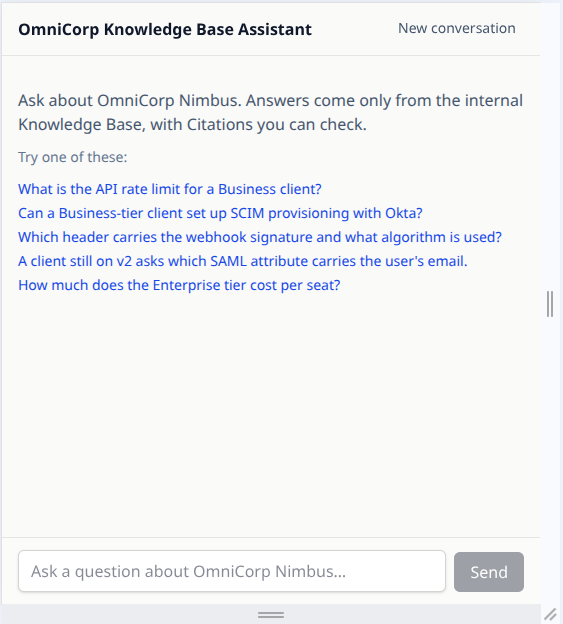
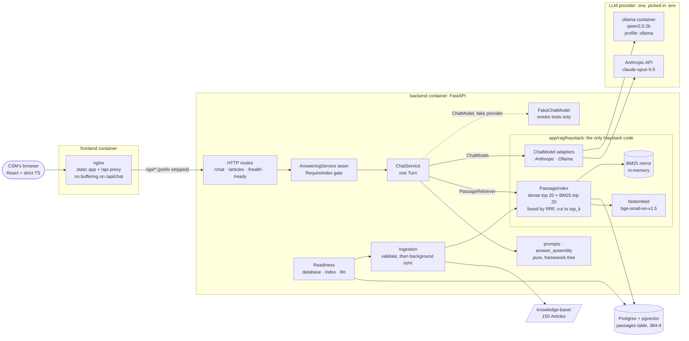
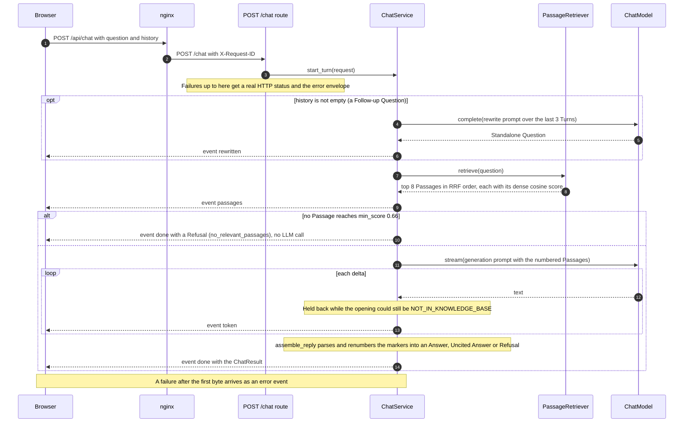

<p align="center">
  
</p>


# OmniCorp Knowledge Base Assistant

A RAG chatbot for OmniCorp's Customer Success Managers (CSMs). A CSM asks a question about the OmniCorp Nimbus product in plain English and gets an Answer drawn only from internal Articles, with every claim tied to a numbered Citation that opens the cited Section. When the Knowledge Base doesn't cover a question, the assistant refuses instead of guessing.

- **Backend:** Python 3.13, FastAPI, [Haystack 3.x](https://docs.haystack.deepset.ai/docs/intro) building blocks, Postgres + pgvector, fastembed `bge-small-en-v1.5`. The chat model is Claude by default, or a keyless local `qwen3.5:2b` through Ollama.
- **Frontend:** React 19, Vite+ and strict TypeScript, with Tailwind and TanStack Query. The API types are generated from the backend's OpenAPI schema.
- **Run and test:** [pixi](https://pixi.sh) installs every tool, and Docker Compose runs the stack. CI has three jobs: checks, a retrieval eval that gates on recall, and a keyless end-to-end smoke test through nginx.
- **Knowledge Base:** 150 Markdown Articles about the fictional Nimbus product. 5 Articles carry the planted hard cases, and 145 are generated from a committed fact sheet in `eval/corpus/`. Together they make 1,150 Passages, and 15 of the generated Articles describe the deprecated v2 platform.

Domain terms (Article, Section, Passage, Citation, Turn, Follow-up Question, Standalone Question, Uncited Answer, Refusal, Golden Question) are defined in [`GLOSSARY.md`](GLOSSARY.md). Every decision below links to its ADR in [`docs/adr/`](docs/adr/) or to its ticket on the planning map, [Map: Enterprise Knowledge Base RAG Chatbot](https://github.com/dragomir-parvanov/epam-preescreen-task-rag/issues/1).

**AI conversation logs:** every Claude Code session that built this repo is in [`chats/`](chats/), one Markdown file per session, named `<start-time>_<first-prompt>.md`. [How AI was used](#how-ai-was-used) explains the process and how the chats were recorded.

**Contents:** [Quick start for reviewers](#quick-start-for-reviewers) · [How to run](#how-to-run) · [What the CSM sees](#what-the-csm-sees) · [Architecture](#architecture) · [API design](#api-design) · [Trade-offs](#trade-offs) · [How to test](#how-to-test) · [Quality](#quality) · [Known limitations](#known-limitations) · [What I'd do next](#what-id-do-next) · [How AI was used](#how-ai-was-used)

## Quick start for reviewers

You need Docker (Engine 25 or later, for the healthcheck's `start_interval`) and [pixi](https://pixi.sh), and nothing else. pixi installs Python, Node and every other tool into the project. To install pixi itself, at the version CI uses:

```sh
curl -fsSL https://pixi.sh/install.sh | PIXI_VERSION=0.81.0 sh   # Linux and macOS; then open a new shell
```

On Windows, in PowerShell: `$Env:PIXI_VERSION='0.81.0'; irm -useb https://pixi.sh/install.ps1 | iex`. On macOS, `brew install pixi` also works. Check it with `pixi --version`. The lockfile covers Linux (x86-64 and ARM), Apple silicon Macs and Windows, but not Intel Macs.

```sh
git clone https://github.com/dragomir-parvanov/epam-preescreen-task-rag.git
cd epam-preescreen-task-rag
cp .env.example .env   # set ANTHROPIC_API_KEY=... in .env
pixi run up            # returns once the stack can answer: about 1.5 to 4 minutes on the first run
```

Open <http://localhost:8080> and ask these in order:

| Ask | What it shows |
| --- | --- |
| Which header carries the webhook signature and what algorithm is used? | A cited Answer. Hover a `[n]` chip, expand a Citation to its verbatim quote, then click "Open Section" to see the whole Article, scrolled to the cited Section |
| and on v2? | A Follow-up Question. "Searched for: …" shows the Standalone Question it was rewritten into, and the Citation carries the `v2` and `Deprecated` badges |
| What is the API rate limit for a Business client? | A version conflict: the v3 limit, with the deprecated v2 limit called out separately |
| How much does the Enterprise tier cost per seat? | A Refusal. The Knowledge Base doesn't cover pricing, so nothing is made up |

**No key?** In `.env`, uncomment `BACKEND_LLM_PROVIDER=ollama` and `COMPOSE_PROFILES=ollama`, then run `pixi run up`. This runs `qwen3.5:2b` locally. The first run downloads about 8 GB, and an Answer takes about 30 s on the CPU. Expect more Uncited Answers than with Claude.

**Ports taken?** If 8080, 8000 or 5432 is already in use, change `FRONTEND_HOST_PORT`, `BACKEND_HOST_PORT` or `POSTGRES_HOST_PORT` in `.env`.

`pixi run test` and `pixi run smoke` run every test with no key ([How to test](#how-to-test)). `pixi run down` stops the stack.

## How to run

The [Quick start](#quick-start-for-reviewers) covers the first run. This section has the details behind it. Besides the app at <http://localhost:8080>, the backend's live API docs are at <http://localhost:8000/docs>.

**Pick an LLM in `.env`.** `pixi run up` first runs `pixi run check-config`, which validates `.env` with the backend's own `Settings`. If the config is invalid, it prints the fix and exits before any Docker build.

- **Claude (the default):** set `ANTHROPIC_API_KEY`, in `.env` or exported in your shell. The default model is `claude-opus-5-5`. `BACKEND_LLM_MODEL=claude-haiku-5-5` is faster and about 40 times cheaper (see [the baselines](#the-full-llm-eval-opt-in)).
- **Keyless, local:** the Ollama profile runs `qwen3.5:2b` in an `ollama` container. Its first `up` downloads the 5.0 GB Ollama image plus the 2.7 GB model; follow the model download with `docker compose logs -f ollama-pull`. `up` waits up to 30 minutes for it. On a Mac, a native Ollama can use the Metal GPU, which a container can't; `.env.example` shows how to point the backend at it.

### First boot and readiness

`pixi run up` returns only once the stack can answer. The backend's Compose healthcheck probes `GET /ready`, which passes when Postgres answers and the Knowledge Base has been synced into the index, and the frontend container waits for a healthy backend. So <http://localhost:8080> answers only after `up` returns; the browser has no first-boot screen of its own.

The first boot embeds all 1,150 Passages on the CPU. That took **about 40 s on a 12-CPU machine and about 137 s on GitHub's 4-vCPU runner** ([Build the Compose smoke job in CI](https://github.com/dragomir-parvanov/epam-preescreen-task-rag/issues/30)). Later boots re-embed only the Passages that changed. Follow it with `docker compose logs -f backend`: it logs `index_sync_progress` lines (`done` of `total`, every 100 Passages), then `index_synced`.

The healthcheck allows 300 s for the first sync before it marks the backend unhealthy. On a 2-CPU Docker Desktop VM, that could be tight. If `up` gives up there, give Docker Desktop more CPUs, or let the backend finish: it keeps syncing, and each batch of 100 Passages is written as it completes. Once the logs show `index_synced`, run `pixi run up` again.

At startup the backend:

1. validates every Article in `knowledge-base/` (bind-mounted read-only). A malformed Article stops it with a log line naming the file, so `up` fails;
2. syncs the index in the background, re-embedding only the Passages that changed, under a Postgres advisory lock. A failed sync is retried with backoff, at most 30 s apart, and `/ready`'s `index` check shows the last error meanwhile. An error that retrying can't fix, such as a stored embedding dimension that doesn't match, stops the retries and points at `pixi run reindex`.

`GET /ready` also reports an `llm` check: is the key valid, and is the Ollama model pulled? A provider outage doesn't make the stack unready, because no instance could fix it. The page's readiness banner shows it instead.

### Stopping, re-indexing and developing

- **`pixi run down`** runs `docker compose down`. It keeps the `postgres-data` volume (the index) and the `ollama-models` volume. It stops the Ollama containers only while `COMPOSE_PROFILES=ollama` is set, in `.env` or in the shell. After you switch back to Claude, `docker compose --profile ollama down` stops them.
- **`docker compose down -v`** also deletes both volumes: the next boot re-embeds everything, and a keyless run downloads the model again.
- **To pick up an edited Article**, restart the backend with `docker compose restart backend`. Startup syncs only what changed.
- **`pixi run reindex`** stops the backend, drops and rebuilds the index, then starts the backend again and waits for it. It leaves the Ollama models alone. The page shows a readiness banner while the backend is down.
- **`pixi run ingest`** syncs the index once, in the backend image. It runs the same sync that startup does, and it is safe while the backend runs.
- **`pixi run dev-backend`** (uvicorn with reload on port 8000) and **`pixi run dev-frontend`** (the Vite+ dev server, which proxies `/api` to port 8000 the way nginx does) run the app on the host. The dev backend needs Postgres: `docker compose up -d postgres`.

| Task | What it does |
| --- | --- |
| `pixi run up` / `pixi run down` | Start the stack (after `check-config`) and wait until it can answer / stop it |
| `pixi run check-config` | Validate `.env` and the shell's backend settings; exits non-zero with the fix |
| `pixi run ingest` | Sync the index with `knowledge-base/` once, in the backend image (what startup does) |
| `pixi run reindex` | Stop the backend, drop and rebuild the index, start the backend again |
| `pixi run dev-backend` / `pixi run dev-frontend` | Run the backend (with reload) and the Vite+ dev server on the host |
| `pixi run lint` | ruff, plus `vp check` (oxfmt and type-aware oxlint) |
| `pixi run typecheck` | pyright (strict) and the frontend's TypeScript, through `vp check` |
| `pixi run test` | pytest and Vitest. Keyless; needs Docker for the `pgvector` tests ([How to test](#how-to-test)) |
| `pixi run smoke` | What CI's `smoke` job runs: the whole stack on the keyless `fake` LLM, checked through nginx |
| `pixi run eval-retrieval` | The keyless retrieval eval that CI gates on ([Quality](#quality)) |
| `pixi run eval` | The opt-in full LLM eval with a real model; never in CI ([Quality](#quality)) |
| `pixi run gen-types` / `pixi run check-types-fresh` | Regenerate the frontend's API types from the OpenAPI schema / fail if the committed ones are stale |
| `pixi run generate-corpus` | Regenerate the 145 generated Articles with Claude (needs a key; never run in CI) |

## What the CSM sees

- **One reading column of Turns.** Tokens stream in as the model writes. A Follow-up Question shows "Searched for: …", the Standalone Question it was rewritten into, so a bad rewrite is visible. Stop cancels the Turn and the model call behind it.
- **Inline `[n]` chips** in the Answer, with a quick look on hover or focus. While the Answer streams, the provisional markers are hidden, so the CSM never sees them renumber. The final text and Citations arrive in `done` and replace the streamed text.
- **A Citations list under each Answer.** Each row shows the Article, the Section path and badges (`v2`, `Deprecated`), and it expands to the verbatim quote, formatted as Markdown. "Open Section" opens the whole Article in a slide-over panel, scrolled to the cited Section and highlighted. A deprecated v2 Article keeps a pinned banner with its end-of-support date.
- **Uncited Answer:** an amber warning, with the retrieved Passages shown as "Retrieved, not cited". They are never promoted to Citations ([ADR-0001](docs/adr/0001-citations-are-model-marked-passages.md)).
- **Refusal:** a neutral box with the fixed message "The Knowledge Base doesn't cover this question." It carries no Citations.
- **Errors:** one card per error `code`, with an "Ask again" button and the request id to quote.
- **Readiness banner:** the page polls `/api/ready`, on load, every 5 s while a check fails and once after an operational Turn error, and shows the most severe state. During `pixi run reindex` or a backend restart, the CSM can keep typing; Send waits only while `database` or `index` fails. ([Build the readiness banner](https://github.com/dragomir-parvanov/epam-preescreen-task-rag/issues/38).)

## Architecture



- **Ports and adapters.** `ChatService` depends on two small `Protocol`s: `PassageRetriever` (in `app/passages.py`) and `ChatModel` (in `app/chat_model.py`). Every Haystack import sits in `backend/app/rag/haystack/`, and `import_boundary_test.py` fails the build if one appears anywhere else. The routes, `ChatService`, the prompts and answer assembly never see a Haystack type ([ADR-0003](docs/adr/0003-haystack-for-building-blocks-our-service-runs-the-chat-flow.md)).
- **The answering seam.** `POST /chat` runs a Turn through `AnsweringService.start_turn`. `ChatService` fills it in the running app, and a scripted stub fills it in route tests. `RequireIndex` wraps it and returns `index_not_ready` until the first sync completes.
- **One store, one derived mirror.** pgvector holds the Passages and their embeddings and is the only source of truth ([ADR-0004](docs/adr/0004-pgvector-as-the-passage-store.md)). The BM25 index is an in-memory Haystack store rebuilt from pgvector at every startup ([ADR-0005](docs/adr/0005-hybrid-retrieval-with-an-in-memory-bm25-mirror.md)).
- **The only Haystack `Pipeline`** is the straight-line indexing one: split, embed, write. The chat flow is plain async Python.

### A Turn



1. **Rewrite (Follow-ups only).** History reaches only the rewrite, never generation ([ADR-0002](docs/adr/0002-history-feeds-only-the-follow-up-rewrite.md)). The client sends it with each request; the server keeps the last 3 Turns and cuts each answer to 500 characters. An unusable rewrite fails the Turn with `rewrite_failed`, rather than silently searching with the raw question.
2. **Retrieve.** pgvector and the BM25 mirror each return 20 candidates. RRF fuses them, and the list is cut to `top_k` = 8. RRF only orders the list: every Passage carries its dense cosine score, and only that score drives the gate.
3. **Gate.** If no Passage scores at least `min_score` = 0.66, the Turn is a Refusal and the model is never called.
4. **Stream.** The prompt holds the numbered Passages, each with its Section path, `applies_to` and `status`. A reply that opens with the sentinel `NOT_IN_KNOWLEDGE_BASE` becomes a Refusal, so `ChatService` holds tokens back while the opening could still be the sentinel. Once it is, generation stops.
5. **Assemble.** Pure code in `answer_assembly.py` accepts `[n]`, `[n][m]` and `[n, m]`, drops markers that point at no Passage, and renumbers the rest by first appearance. With no valid marker left, the reply is an Uncited Answer ([ADR-0001](docs/adr/0001-citations-are-model-marked-passages.md)).
6. **`done`** carries the authoritative `ChatResult`. Every Turn logs one `turn_completed` line with its timings, outcome and request id, and no question or answer text at INFO.

Each awaited step gets its own deadline (120 s for a Claude Turn, 240 s for Ollama, 30 s for the rewrite). None is held open across a `yield`, and all stay under nginx's 300 s read timeout. Stop, a client disconnect or a shutdown cancels the Turn's task, and the `ChatModel` adapter then closes the HTTP connection to the provider.

**Measured with real Claude** (`claude-opus-5-5`, 14 Turns through nginx): time to first token was about 0.7–6 s, and a whole Turn took about 2.2–9.5 s. A Follow-up adds about 1.0–1.3 s of rewrite before `passages`. A model Refusal streams no tokens and arrives whole in `done`, about 2 s in.

### Module layout

```text
backend/app/
  main.py                app factory and wiring (uvicorn --factory app.main:create_app_from_env)
  config.py              Settings, per-provider defaults, load_settings() (exits with the fix)
  check_config.py        the host-side config check that `pixi run up` runs first
  chat/routes.py         POST /chat: SSE framing; failures after the first byte become `error` events
  chat/schemas.py        wire types: ChatRequest, ChatStreamEvent, ChatResult
  chat/answering.py      the AnsweringService seam, RequireIndex, the demo stub for route tests
  chat/service.py        ChatService: one Turn
  prompts.py             PROMPT_VERSION, the generation and rewrite prompts (pure, snapshot-tested)
  answer_assembly.py     the gate, the sentinel, marker parsing and renumbering (pure)
  passages.py            Passage and the PassageRetriever port
  chat_model.py          the ChatModel and LlmProbe ports
  fake_chat_model.py     the keyless canned model for the smoke job
  articles.py            GET /articles and /articles/{id}
  knowledge_base.py      Article loading and Section splitting (kept in step with Haystack's splitter by a test)
  ingestion.py           startup: validate, then sync in the background (advisory lock, backoff)
  ingest.py              python -m app.ingest [--rebuild]
  readiness.py           GET /ready
  errors.py              the error envelope, its codes and their HTTP statuses
  logs.py, request_id.py structlog JSON lines, X-Request-ID
  rag/haystack/          the only Haystack code: index, retrieval, embedding, splitting, generators, LLM probe
backend/evaluation/      golden schema, corpus lint, generate-corpus, eval-retrieval, the full LLM eval
backend/smoke/           pixi run smoke
frontend/src/
  api/                   the committed openapi.json, the generated schema.d.ts, the openapi-fetch client
  chat/                  stream parsing, the Turn reducer, Citations, the in-house Markdown renderer
  article/               the Article panel
  readiness/             the readiness banner
knowledge-base/          the 150 Articles
eval/                    golden-questions.yaml, corpus/ (the plan and the fact sheet), results/ (baselines)
```

## API design

Every path is served under `/api` through nginx, and nginx strips the prefix. The live docs are at <http://localhost:8000/docs>. The schema is committed as [`frontend/src/api/openapi.json`](frontend/src/api/openapi.json), and the frontend's types are generated from it. CI's `check-types-fresh` fails when the committed types are stale, so an API change shows up in review on both sides ([HTTP API contract](https://github.com/dragomir-parvanov/epam-preescreen-task-rag/issues/13)).

| Endpoint | What it does |
| --- | --- |
| `POST /chat` | One Turn, streamed as Server-Sent Events. Body: `{question, history?: [{question, answer}]}` |
| `GET /articles` | Every Article with its Section outline |
| `GET /articles/{id}` | One whole Article, split into Sections whose `id`s match the Passages' `section.id`, for Citation click-through |
| `GET /health` | Liveness: the process is serving |
| `GET /ready` | Readiness: `{status, checks: {database, index, llm}}`, 200 or 503. Only `database` and `index` gate |

**`POST /chat` is SSE only.** Each frame is `event: <type>` plus `data: <json>`, and every payload is discriminated on `type`:

```text
rewritten  {standalone_question}          Follow-ups only
passages   {passages: [Passage]}          before any token, numbered in prompt order
token      {text}                          raw model text, provisional
done       {result: ChatResult}           authoritative: replaces everything streamed before it
error      {error: ErrorBody}             a failure after the stream has started
```

`ChatResult` is a union on `type`: `answer` (`text`, `citations: [{n, passage}]`), `uncited_answer` (`text`) or `refusal` (`message`, `reason`: `no_relevant_passages` or `not_in_context`). All three also carry `retrieved_passages` and `standalone_question`. A `Passage` carries its Article, its Section (`id` and heading path), its verbatim `text`, `applies_to`, `status` and its dense cosine `score`. Retrieved Passages are always returned next to the Citations and never mixed in, so the eval can tell a retrieval failure from a citation failure.

```sh
curl -N http://localhost:8080/api/chat -H 'Content-Type: application/json' \
  -d '{"question": "What does error AUTH-401 mean?"}'
```

**Errors.** Every error is one envelope: `{"error": {"code", "message", "details"?, "request_id"}}`. The `message` is safe to show the CSM, and `details` lists the field errors of a `validation_error`. Anything detectable before the first byte gets a real HTTP status. After that the status is already 200, so the same body arrives as an `error` event. On `POST /chat`, that means a bad body and `index_not_ready` get a status, while the retrieval and LLM codes below arrive as `error` events.

| `code` | Status | When |
| --- | --- | --- |
| `validation_error` | 422 | Bad body: a blank question, over 2,000 characters, over 20 history Turns |
| `not_found` / `method_not_allowed` | 404 / 405 | No such Article or path / wrong method |
| `index_not_ready` | 503 | The first sync hasn't completed |
| `retrieval_unavailable` | 503 | Postgres can't be reached |
| `llm_not_configured` | 503 | In the contract; in practice, startup refuses to run without a valid LLM config |
| `llm_auth_failed` | 502 | The provider rejected the key |
| `llm_unavailable` | 503 | The provider is down, or returned an empty reply |
| `llm_timeout` | 504 | A read timeout, or the Turn's deadline |
| `rewrite_failed` | 502 | A Follow-up's rewrite held no usable Standalone Question |
| `internal_error` | 500 | Anything else; the details go to the logs only |

**`request_id`.** nginx mints an `X-Request-ID` for every `/api` request. The backend binds it to every log line, echoes it in the response header and puts it in the envelope. The error card shows it, so a CSM's screenshot leads to the exact log lines.

**Conventions.** Paths are unversioned behind `/api`. Fields are snake_case end to end, with no aliases. There is no CORS, because nginx serves the app and the API from one origin. nginx passes `/api/chat` through unbuffered.

## Trade-offs

Each entry is the call, why, and what it costs. The ADRs and tickets hold the full reasoning and the options rejected.

**Citations are the Passages the model marked; Uncited Answers are flagged, never padded** ([ADR-0001](docs/adr/0001-citations-are-model-marked-passages.md), [Citation & grounding contract](https://github.com/dragomir-parvanov/epam-preescreen-task-rag/issues/7)). "Cited" always means "the model claimed to use it". An Answer with no valid marker is shown with a warning rather than dressed up with the retrieved Passages. Cost: "used" is the model's claim, not verified per request. The eval's citation precision and recall are the check, and the Uncited rate was 0% in every Claude baseline.

**History feeds only the Follow-up rewrite; the client sends it, and nothing is stored** ([ADR-0002](docs/adr/0002-history-feeds-only-the-follow-up-rewrite.md), [Conversation model: single vs multi-turn, streaming](https://github.com/dragomir-parvanov/epam-preescreen-task-rag/issues/8)). Generation sees only this Turn's Passages, so every Citation is tied to this Turn's retrieval. There's no session store and nothing to lose on restart. Cost: one extra LLM call per Follow-up (about 1.0–1.3 s on Claude), and a bad rewrite is a new failure mode. The UI shows the Standalone Question so the CSM can spot one.

**SSE only, with an authoritative `done`** ([HTTP API contract](https://github.com/dragomir-parvanov/epam-preescreen-task-rag/issues/13)). Streaming matters for a 5 s Answer. A JSON twin endpoint was dropped: tests and the eval call the answering service in-process, `curl -N` reads the stream, and `done` already carries the whole result as one object. Tokens are provisional, and `done` replaces them, so renumbering Citations never needs to happen mid-stream.

**Haystack 3.x for the building blocks; our own `ChatService` runs the Turn** ([ADR-0003](docs/adr/0003-haystack-for-building-blocks-our-service-runs-the-chat-flow.md), [Choose the RAG framework](https://github.com/dragomir-parvanov/epam-preescreen-task-rag/issues/9)). Haystack gives the Markdown splitter, the embedders, the pgvector store and the provider generators, along with test fakes. A Haystack query `Pipeline` with `stream()` was rejected: it emits Passages after the tokens, and it has no natural place for a gate that refuses without calling the LLM, for failing the Turn on a bad rewrite, or for cancelling on Stop. `AnswerBuilder` is unused too, so one framework-free module owns the citation contract. The risk is a major version that shipped in July 2026: most examples online, and most AI-generated code, are 2.x and don't run. Every Haystack package is exact-pinned, all of it sits behind two `Protocol`s in one package, and `AGENTS.md` sends agents to the 3.x docs. LangChain 1.x was the runner-up ([framework research](research/rag-frameworks.md)).

**pgvector, even at prototype scale** ([ADR-0004](docs/adr/0004-pgvector-as-the-passage-store.md), [Choose the vector store](https://github.com/dragomir-parvanov/epam-preescreen-task-rag/issues/11)). An in-memory store would hold 1,150 Passages easily. pgvector is what a real deployment would run, though, so scaling becomes a configuration change rather than a store migration. The index also survives restarts, and a re-ingest is an idempotent sync. Search is exact (a sequential scan takes milliseconds at this size), which keeps the CI-gating eval deterministic. HNSW is the named scaling lever. Cost: one more container, and `pixi run test` needs Docker, because the adapter tests run against a real pgvector from the same pinned image.

**Hybrid retrieval: dense + BM25, fused by RRF, no reranker** ([ADR-0005](docs/adr/0005-hybrid-retrieval-with-an-in-memory-bm25-mirror.md), [Chunking & retrieval strategy](https://github.com/dragomir-parvanov/epam-preescreen-task-rag/issues/12)). The 150 Articles share repeated Section skeletons, and identifiers like `AUTH-401` are exactly where `bge-small` blurs. BM25 adds 13–17 points of recall@8 over dense-only. Postgres full-text search was rejected for the keyword leg: `plainto_tsquery` needs every word to match, and `ts_rank_cd` has no IDF. So BM25 runs on an in-memory mirror rebuilt from pgvector at startup, which takes milliseconds at this size and is worth revisiting past about 100k Passages. One Passage per Section (split again over about 250 words, with no overlap) means every Citation points at exactly one Section, which "Open Section" can scroll to. There's no reranker because a reranker can only reorder candidates. Both known misses rank 20th or lower, so a reranker over the top 20 can't recover them. It would earn its place if the eval showed answering Sections stuck at ranks 9–20.

**`min_score` is a floor, not a separator** ([Build the golden schema and keyless retrieval eval in CI](https://github.com/dragomir-parvanov/epam-preescreen-task-rag/issues/28)). The weakest answerable question's dense top-1 is 0.712, so `min_score` = 0.712 − 0.05 = 0.66, and no answerable question is refused. Off-topic questions score about 0.35–0.40 and are refused before the model is called. Unanswerable questions near a covered topic (LDAP, prices, SAML single logout) score 0.65–0.80, the same range as answerable ones, so no cosine threshold separates them, and the gate refuses only 1 of the 13. The second line of defence is the model's `NOT_IN_KNOWLEDGE_BASE` sentinel. With `bge-small`, almost every Refusal comes from the model (`not_in_context`), not the gate.

**The sentinel, the fixed Refusal and the gap wording** ([Prompt design](https://github.com/dragomir-parvanov/epam-preescreen-task-rag/issues/19), [Soften the partial-answer gap statement](https://github.com/dragomir-parvanov/epam-preescreen-task-rag/issues/42)). One prompt serves every provider. Its worked example is about a made-up product, so the prompt holds no Knowledge Base facts. A Refusal is detected when the reply opens with the sentinel, and the CSM sees a fixed server message, never the model's words. A partially answerable question gets an Answer to the covered part, plus one sentence naming the gap. Prompt v1's gap sentence was "The Knowledge Base doesn't cover …". On a retrieval miss, that made Claude claim the absence of facts the Knowledge Base contains. Prompt v2 says "I couldn't find anything in the Knowledge Base about …" and forbids claiming absence. The fixed Refusal message ("The Knowledge Base doesn't cover this question.") is unchanged, because it covers the whole question, and a gate Refusal on a retrieval miss carries the same false-absence risk. Softening it is a one-line follow-up.

**Claude by default; Haiku as the cheap option; Ollama keyless** ([Choose the LLM & embedding providers and their configuration](https://github.com/dragomir-parvanov/epam-preescreen-task-rag/issues/10), [Build the ChatModel adapter with streaming and Stop](https://github.com/dragomir-parvanov/epam-preescreen-task-rag/issues/22)).
- **`claude-opus-5-5` at effort `low`.** Thinking can't be turned off on Opus 5.5, so effort is the latency control. Claude gets no `temperature`, `top_p` or `top_k`: the API rejects them since version 2026-10-21. So test determinism comes from fakes, and real runs vary (see [Known limitations](#known-limitations)).
- **`claude-haiku-5-5`** scored 72% on the curated eval against Opus's 80%, for $0.013 a run against $0.51.
- **Keyless `qwen3.5:2b` through Ollama**, at temperature 0 and with `think=False` so `<think>` blocks can't hide the sentinel. Small local models cite poorly: in the [provider research](research/llm-embedding-providers.md), `llama3.2:3b` emitted no `[n]` markers at all, and answers took about 13–19 s on CPU. Expect more Uncited Answers there. There's no committed Ollama baseline, by choice.
- **No OpenAI.** Both providers use Haystack's native generators, and the cancellation tests proved no SDK fallback was needed.
- **No key, no start.** A missing key fails fast with both fixes printed, on the host (`check-config`) and in the container.

**The embedder is fixed and in-process** ([LLM & embedding provider options for a keyless or BYOK local run](https://github.com/dragomir-parvanov/epam-preescreen-task-rag/issues/4), [Choose the LLM & embedding providers and their configuration](https://github.com/dragomir-parvanov/epam-preescreen-task-rag/issues/10)). fastembed `bge-small-en-v1.5` (384 dimensions) is baked into the backend image. So the index never depends on which LLM you pick, startup never downloads a model, and retrieval needs no key. That is why the retrieval eval can gate CI. Cost: a small English model. A bigger embedder is a rebuild of a derived index, and startup fails fast on a dimension mismatch.

**First-boot embedding: one Passage per call, threads from the cgroup quota** ([Build the Compose smoke job in CI](https://github.com/dragomir-parvanov/epam-preescreen-task-rag/issues/30)). fastembed's default batch of 256 pads every Passage to the longest in its batch: on 4 CPUs that was 8 Passages/s, against 32/s one at a time. Under a container CPU quota, onnxruntime sized its thread pool from the host's CPU count and ran 3 times slower. Fixing both took the first sync from 150 s to 40 s locally, and from over 300 s to 137 s on the CI runner.

**One Compose healthcheck that probes readiness** ([Operational readiness: config, health, ingestion lifecycle, logging](https://github.com/dragomir-parvanov/epam-preescreen-task-rag/issues/15), [Build the startup ingestion lifecycle and readiness checks](https://github.com/dragomir-parvanov/epam-preescreen-task-rag/issues/35)). Compose has one healthcheck per service, so it probes `/ready`, and `up --wait` then means "can answer". Kubernetes would get two probes: `/health` for liveness, `/ready` for readiness. `llm` is reported but doesn't gate, because a provider outage would mark every instance unready, and none of them could fix it.

**nginx and SSE** ([Build the Compose smoke job in CI](https://github.com/dragomir-parvanov/epam-preescreen-task-rag/issues/30)). `proxy_buffering off` on `/api/chat` turned out to be belt and braces: FastAPI's `EventSourceResponse` sends `X-Accel-Buffering: no`, which nginx already honours. What really buffers the stream is gzip on `text/event-stream`. The smoke job asks for gzip as a browser does, and it fails when the `token`s arrive all at once, which happened when gzip was switched on for that route.

**The `fake` LLM provider is for the smoke job only** ([Build the Compose smoke job in CI](https://github.com/dragomir-parvanov/epam-preescreen-task-rag/issues/30)). `BACKEND_LLM_PROVIDER=fake` replays a canned, cited reply, so CI can run the real stack (image builds, the Knowledge Base mount, ingestion, `/ready`, nginx streaming) with no secrets, and on PRs from forks. It is never a default, and the full eval refuses it.

**150 Articles, not 3–5** ([Knowledge-base corpus: domain, articles, metadata and planted hard cases](https://github.com/dragomir-parvanov/epam-preescreen-task-rag/issues/6), [Generate the remaining 145 Articles and their Golden Questions](https://github.com/dragomir-parvanov/epam-preescreen-task-rag/issues/34)). The brief suggests 3–5 mock Articles, but its CSMs search "hundreds of internal product manuals". Five Articles can't test retrieval: every Section would come back. 150 Articles with repeated skeletons, near-duplicates and a deprecated v2 platform make retrieval, versioning and refusal measurable.

## How to test

`pixi run test` runs pytest and Vitest. It needs no key, and it is offline once the pinned `pgvector/pgvector` image has been pulled. It needs Docker for the tests marked `pgvector`, which start a real Postgres through `testcontainers` and **error, never skip**, when Docker isn't running, so a broken adapter can't pass silently. To leave them out, run `pytest -m 'not pgvector'` in `backend/`.

Tests sit next to the code they test. Each one's layer is chosen by what it proves ([Test & evaluation strategy](https://github.com/dragomir-parvanov/epam-preescreen-task-rag/issues/16)):

| Layer | What it proves | How |
| --- | --- | --- |
| Pure logic | Answer assembly, the prompts (snapshot-tested), history capping, Section slugs | Plain unit tests |
| `ChatService` | Event order, the gate, the sentinel hold-back, deadlines, Stop | Hand-written fakes of `PassageRetriever` and `ChatModel`, through those interfaces |
| Haystack adapter | Indexing, sync, hybrid retrieval, each generator's streaming and cancellation | Haystack's own fakes with a keyword-overlap `embedding_fn`, over a real pgvector. Each generator runs against an in-process fake server that speaks the provider's streaming protocol, so cancelling the Turn must close a real connection |
| Routes | Status codes, the envelope, SSE framing, `request_id` | `TestClient` over a stub answering service |
| The wiring | The images, the Knowledge Base mount, ingestion, `/ready`, nginx streaming | Only `pixi run smoke` (below), on the keyless `fake` LLM |
| Frontend | What the CSM sees: streaming, chips, Citations, the panel, error cards, the banner | Vitest, Testing Library and MSW, with SSE bodies streamed as a `ReadableStream` |

Beyond the unit layers:

- **`pixi run smoke`**: the one-command end-to-end check, keyless. It brings up the whole stack as its own Compose project, on ports 18080, 18000 and 15432 with the `fake` LLM. Through nginx, it checks `/ready`, the Articles, a streamed cited Answer, a Follow-up and a Refusal. It also checks that the `token`s are spread out in time, which proves nginx isn't buffering. Then it removes the stack and its volume.
- **`pixi run eval-retrieval`**: the retrieval eval, with the real embedder. It gates CI (see [Quality](#quality)).
- **`pixi run eval`**: the full LLM eval with a real model. It is opt-in and never gates (see [Quality](#quality)).

**CI** ([`.github/workflows/ci.yml`](.github/workflows/ci.yml)) runs three jobs in parallel on every push to `main` and every PR, all pinned to `ubuntu-24.04`, since the healthcheck's `start_interval` needs Docker Engine 25 or later:

1. **`checks`:** `pixi run lint`, `typecheck`, `test` (with the `pgvector` tests) and `check-types-fresh`. About 1.5 minutes.
2. **`eval-retrieval`:** the retrieval eval. It fails below the recall bars, or if the gate refuses any answerable question.
3. **`smoke`:** `pixi run smoke`. About 4 minutes: about 60 s of image builds, about 137 s of first sync, then seconds of checks.

## Quality

Quality is measured against 317 Golden Questions in [`eval/golden-questions.yaml`](eval/golden-questions.yaml). 27 are curated: hand-designed to probe the planted hard cases (version conflicts, near-duplicates, table lookups, cross-Article questions, partials, Follow-ups and 13 unanswerables). The other 290 are generated, two per generated Article. Each question states the outcome it expects, the Sections it should cite (with checked alternatives where another Section states the same fact), and the terms the Answer must mention.

### Retrieval eval (keyless, gates CI)

`pixi run eval-retrieval` indexes the Knowledge Base with the real embedder in a throwaway pgvector, which needs Docker and takes about 1.5 minutes on 12 CPUs. For each Golden Question, it prints where the expected Sections rank and what the gate does. A question counts as found when each of its expected sources (that Section or a listed alternative) is in the top `top_k`. The bars are 100% of curated and 95% of generated answerable questions, with no answerable question refused by the gate. k and `min_score` come from `Settings`, so a change to either is checked the same way.

At the defaults (`top_k` 8, `min_score` 0.66), on 150 Articles (1,150 Passages) and 317 Golden Questions:

| recall@8 | hybrid (served) | dense-only | hybrid, no query prefix |
| --- | --- | --- | --- |
| curated (12, plus 2 known misses) | 100% | 83.3% | 100% |
| generated (290) | 95.5% (277; the bar needs 276) | 82.1% | 94.8% |

- **Hybrid pays for itself:** BM25 adds 13–17 points over dense-only.
- **The bge query prefix is neutral**, within a point either way, so it stays on, as the model recommends.
- **The gate is a floor** (see [Trade-offs](#trade-offs)). It refuses no answerable question, and 1 of the 13 unanswerable ones.
- **`top_k` is 8, the cap.** No smaller k meets the bars.

### The full LLM eval (opt-in)

`pixi run eval` runs the 27 curated questions through the real `ChatService` and the configured LLM, over a throwaway pgvector ([Build the full LLM evaluation and baseline reports](https://github.com/dragomir-parvanov/epam-preescreen-task-rag/issues/29)). It needs Docker and `ANTHROPIC_API_KEY`, or `BACKEND_LLM_PROVIDER=ollama` with a pulled model; it refuses `fake`. It never gates CI, because it needs a key, and Claude's runs don't repeat exactly.

```sh
pixi run eval                                # the 27 curated questions, with the .env model
pixi run eval --model claude-haiku-5-5       # override the model for one run
pixi run eval --all --concurrency 4          # all 317 questions
pixi run eval --only gq-auth-401 gq-ldap     # just these questions; writes no files
```

It scores the outcome (Answer, partial Answer or Refusal), Section-level citation precision and recall, retrieval recall, the Uncited rate, `must_mention` terms, latency, TTFT and cost. It writes a Markdown and a JSON report to [`eval/results/`](eval/results/). Each run spends about 35 s indexing. Measured costs at list price: about $0.51 and 2 minutes for Opus on the curated set, $0.013 for Haiku, and $7.68 and 7 minutes for Opus on all 317.

The committed baselines (prompt v2, `top_k` 8, `min_score` 0.66, effort `low`, all at `927a9b6`). Start with [the Opus curated report](eval/results/anthropic-claude-opus-5-5-v2-curated.md).

| | [Opus 5.5, curated](eval/results/anthropic-claude-opus-5-5-v2-curated.md) | [Haiku 5.5, curated](eval/results/anthropic-claude-haiku-5-5-v2-curated.md) | [Opus 5.5, all 317](eval/results/anthropic-claude-opus-5-5-v2-all.md) |
| --- | --- | --- | --- |
| Outcome accuracy | 80.0% (20/25) | 72.0% (18/25) | 95.2% (300/315) |
| Unanswerable refused | 8/13 (5 soft) | 6/13 (7 soft) | 9/13 (4 soft) |
| Answerable refused | 0 | 0 | 1 (a retrieval miss) |
| Citation precision | 45.4% | 73.6% | 30.1% |
| Citation recall | 100% | 100% | 94.9% |
| Retrieval recall | 100% | 100% | 96.0% |
| Uncited rate | 0% | 0% | 0% |
| `must_mention` hit rate | 100% | 100% | 94.4% |
| Latency p50 / p95 | 4.2 / 6.5 s | 1.9 / 4.5 s | 5.1 / 7.3 s (at concurrency 4) |
| Cost of the run | $0.51 | $0.013 | $7.68 |

How to read the table:
- **Outcome** is over 25 or 315 questions: the 2 known retrieval misses are reported separately.
- **"Soft"** means a gap Answer where a Refusal was due (see below).
- **Citation precision is low on purpose.** Claude cites extra, correct Sections (a v2 caveat, a neighbouring error code) that aren't in the question's expected Sections, so read precision as focus, not as wrong Citations. Haiku stays closer to the question.
- **Citation recall and the Uncited rate** are the grounding numbers that matter: known misses aside, every answerable curated question cited its expected Section, and no Answer came back Uncited.

## Known limitations

- **Two known retrieval misses.** `gq-google-sso` ("set up SSO with Google Workspace") pulls in workspace-setup Sections, and *Configuring SSO with SAML 2.0 › Attribute mapping* ranks 20th. `gq-entra-auto-deprovision` ("leavers removed automatically") shares no words with SCIM or deprovisioning, so neither the SCIM *Prerequisites* nor the *Deprovisioning* Section reaches the top 20. A larger k, the query prefix and a reranker over these candidates don't help. Under prompt v1, Claude then wrote "The Knowledge Base doesn't cover …" about facts the Knowledge Base contains. Prompt v2 turns that into "I couldn't find …", which is true, but the Answer still lacks the missed facts. The fix is query expansion ([What I'd do next](#what-id-do-next)).
- **Soft refusals.** For unanswerable questions close to a covered topic (OneLogin, Ping Identity, Active Directory sync, Google Workspace provisioning), Claude often answers the neighbouring facts and adds "I couldn't find …" instead of refusing. The Answers read stayed grounded and cited, but the prompt asks for a Refusal. This is the main model failure in every baseline.
- **Gap sentences about details nobody asked about.** On 7 fully answered generated questions, Opus added an "I couldn't find …" sentence about an adjacent detail, such as `gq-api-approvals-2` and its "`expires_at` field specifically".
- **Run-to-run variation.** Claude takes no sampling parameters, so its runs never repeat exactly. Opus scored 84%, then 80%, on the curated set with the same pipeline. Read one-question differences between runs as noise.
- **The generated recall bar passes by one question:** 277 of 290 are found, and the bar needs 276. Settling four contradictions between generated Articles, and checking four more alternative Sections, is what got it over the line. A corpus edit can tip it back, and CI would catch that.
- **The generated Articles have small inconsistencies** that no rule covers, such as two shapes of audit-event JSON and two labels for "Reset two-factor" ([Generate the remaining 145 Articles and their Golden Questions](https://github.com/dragomir-parvanov/epam-preescreen-task-rag/issues/34)).
- **Cross-Article links render as plain text** in the Article panel: a link to another Article can be read but not followed ([Build Citation click-through: the Article panel](https://github.com/dragomir-parvanov/epam-preescreen-task-rag/issues/32), still so after [Render Citation quotes as formatted text](https://github.com/dragomir-parvanov/epam-preescreen-task-rag/issues/41)).
- **`python -m app.ingest` needs a valid LLM config**, although indexing never calls the LLM, because it loads the same `Settings` as the server. So `pixi run ingest` and `pixi run reindex` run `check-config` first ([Build the startup ingestion lifecycle and readiness checks](https://github.com/dragomir-parvanov/epam-preescreen-task-rag/issues/35)).
- **History is client-supplied.** A caller can fabricate earlier Turns, which affects only their own Conversation. There is no auth.

## What I'd do next

In rough order of value, each with its first step:

1. **Query expansion, for the known misses.** Let the rewrite step also expand or split the question (always, not only for Follow-ups), then retrieve for each variant and fuse with RRF. The first step is an `eval-retrieval` run with the two known misses unmarked: they are the test.
2. **Prompt v3, for soft refusals and unneeded gap sentences.** Add a near-topic unanswerable worked example, and state that answering only neighbouring facts is a Refusal. The first step is a curated `pixi run eval` against the v2 baselines, run twice, given the run-to-run variation.
3. **A reranker evaluation.** Add a cross-encoder over the top 20 behind `PassageRetriever`, and keep it only if `eval-retrieval` shows a gain at k=8 that pays for its latency. The first step is to log how many answering Sections sit at ranks 9–20.
4. **Metrics and tracing.** OpenTelemetry spans for the rewrite, retrieval and generation, carrying the existing request id; a Prometheus `/metrics` with Turn latency, TTFT, outcomes by type and gate Refusals. The first step is to turn the fields of `turn_completed` into metrics.
5. **Auth and RBAC.** SSO (OIDC) in front of nginx, with the user identity passed to the backend and logged with each Turn. Per-Article permissions would then filter retrieval by the user's groups as a pgvector metadata filter.
6. **Multi-tenancy.** A `tenant_id` on every Passage and a mandatory filter in `PassageRetriever`, one BM25 mirror per tenant, and per-tenant evals.
7. **Deployment.** Two probes (`/health` for liveness, `/ready` for readiness), managed Postgres with pgvector, the key from a secret store, and IaC. The first step is a Helm chart or a container service definition reusing the images CI already builds.
8. **Real document formats and uploads.** Convert PDF and DOCX to Markdown with headings (Docling or a Haystack converter), keep the Section-path contract, and add an upload endpoint that triggers the existing idempotent sync.
9. **Scaling past 150 Articles.** Incremental re-indexing already exists. Next come HNSW in pgvector, tuned against `eval-retrieval`; keyword search in a store with real BM25 once the in-memory mirror stops being cheap (around 100k Passages); and sharding by product or tenant after that.
10. **Saved conversation history** ([Conversation model: single vs multi-turn, streaming](https://github.com/dragomir-parvanov/epam-preescreen-task-rag/issues/8)) and **rate limiting** ([HTTP API contract](https://github.com/dragomir-parvanov/epam-preescreen-task-rag/issues/13)), both pointless for one local user, both needed once there are many.

## How AI was used

Claude Code with Claude Opus 5.5 wrote essentially all the code, tests, docs, ADRs and generated content in this repo. The human set the direction, made the decisions, and chose what to accept. The process was designed to make that split visible and checkable.

**The planning record: a wayfinder map.** [Map: Enterprise Knowledge Base RAG Chatbot](https://github.com/dragomir-parvanov/epam-preescreen-task-rag/issues/1) is a GitHub issue that tracks the destination (this submission), the decisions made so far, and what is out of scope. Each open question became a ticket of one of four kinds:

- **Grilling tickets**, such as the citation contract, the conversation model, the API contract and the providers. The agent asked numbered questions, each with a recommended answer and its reasoning, and the human answered them. The resolution comment records the decision, and the hard-to-reverse ones became ADRs.
- **Research tickets** ([Python RAG framework options: LlamaIndex vs LangChain vs Haystack](https://github.com/dragomir-parvanov/epam-preescreen-task-rag/issues/5), [LLM & embedding provider options for a keyless or BYOK local run](https://github.com/dragomir-parvanov/epam-preescreen-task-rag/issues/4)). Background research subagents read primary sources, ran small spikes and benchmarks, and wrote their findings to [`research/`](research/).
- **One prototype ticket**, for the chat UI. It was built on its own throwaway branch, [`prototype/chat-ui-citations`](https://github.com/dragomir-parvanov/epam-preescreen-task-rag/tree/prototype/chat-ui-citations), which is kept so its three layout variants can still be run against a fake stream.
- **Build tickets**, spawned as soon as a decision was made, so the code grew with the decisions rather than in one go at the end. Build agents ran in parallel, one per ticket, each in its own throwaway git worktree. Each one worked test-first, ran lint, typecheck, test and the type-freshness check after rebasing, pushed straight to `main` once green, watched CI, and posted a resolution comment with what it verified. Hand-offs between tickets are comments that start "Input from …".

**What the human decided, and what the agents did.** The chat logs show it plainly. Most grilling questions were answered "recommended", which accepted the agent's proposal after reading its reasoning. The calls the human made against the recommendation, or beyond it, include these:
- Plan and build at the same time, with tickets on GitHub Issues.
- Use pixi tasks rather than a Makefile, and `testcontainers` for the pgvector tests.
- Use Tailwind, TanStack Query, oxlint and Vite+ on the frontend, with tests next to the code.
- Grow the Knowledge Base from 5 to 150 Articles with test data.
- Make Claude the default, drop OpenAI, and fail fast on a missing key with both fixes printed.
- Commit every change to `main`, with no branches outside prototype work.
- Fix the contradictions in the generated Articles rather than lower the generated recall bar.
- Document the two known retrieval misses, with query expansion as future work.
- Commit no Ollama baseline.

The agents wrote the code and tests, ran the measurements, proposed every number above, and wrote this README.

**How the output was checked.** Nothing here rests on an agent saying it works:
- **TDD** at the layers above, with fakes at our own interfaces and at the HTTP boundary.
- **Strict typing:** `pyright --strict` and strict TypeScript, with the API types generated from the schema.
- **CI on every push** to `main`.
- **The evals and the smoke job**, which caught real problems: the real-Claude end-to-end check found the false "doesn't cover" claims, the smoke job found first-boot embedding outlasting the healthcheck, and the retrieval eval surfaced four contradictions between generated Articles.

**Generated content.** The 5 planted Articles, the Nimbus fact sheet and the 27 curated Golden Questions were written to the spec decided in [Knowledge-base corpus: domain, articles, metadata and planted hard cases](https://github.com/dragomir-parvanov/epam-preescreen-task-rag/issues/6). The other 145 Articles and 290 Golden Questions were generated by Claude Opus 5.5 ([Generate the remaining 145 Articles and their Golden Questions](https://github.com/dragomir-parvanov/epam-preescreen-task-rag/issues/34)). `pixi run generate-corpus prompts` wrote the prompts from `eval/corpus/articles.yaml` and the fact sheet, and subagents answered them in batches. Every reply then went through the same automated review that `generate-corpus run` applies: Article shape, the family's Section skeleton, links, a version-aware lint against the planted facts and forbidden topics, and checks that each Golden Question is grounded in its cited Section. Every 10th generated question (29 in all) was then reviewed against its Section, and 6 had their `must_mention` terms fixed. Golden-source alternatives added later were each backed by a verbatim quote that a script checked.

### Chat recording

The brief requires the AI conversation logs to be committed, so a Claude Code `Stop` hook ([`.claude/hooks/record-session.sh`](.claude/hooks/record-session.sh), registered in [`.claude/settings.json`](.claude/settings.json)) saves every session in this repo to `chats/<start-time>_<first-prompt>.md`.

- Only user and assistant text is kept, so the logs read as a conversation rather than a dump of tool output.
- Each message shows its time and how full the context window was, for example `context 5.7% (57.4k / 1000k)`. That shows when a long session was getting close to the point where answer quality drops.
- The hook records top-level sessions. Research and build agents ran as subagents. Their briefs and final reports appear in the log of the session that launched them, and their work is in the ticket resolution comments and the commits.
